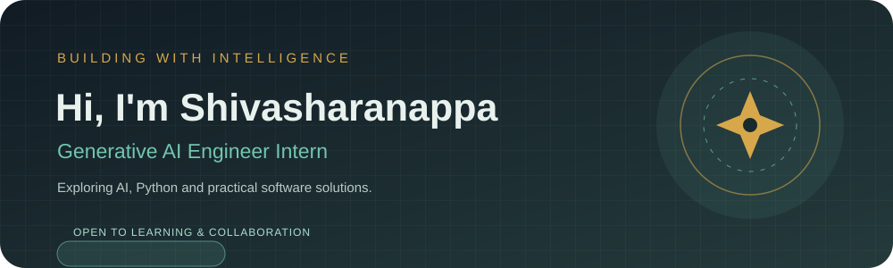

### COMPUTER SCIENCE & DESIGN GRADUATE · AI ENTHUSIAST · DEVELOPER

---

## ✦ ABOUT ME

<table>
<tr>
<td width="64%" valign="middle">

Hi, I'm **Shivasharanappa**.

I'm a Computer Science and Design graduate interested in artificial intelligence, Python, and software development. I enjoy learning by building projects and exploring practical technology solutions.

- 🎓 B.E. in Computer Science and Design
- 💼 Currently an intern at **Pragyan AI**
- 🤖 Interested in practical AI applications
- 🧩 Exploring software development and problem-solving
- 🌱 Always learning and improving my skills

</td>
<td width="36%" align="center" valign="middle">

**BUILD · LEARN · CREATE**

</td>
</tr>
</table>

## ◈ MY JOURNEY

<table>
<tr>
<td align="center" width="33%">

### 🎓 EDUCATION

B.E. in Computer Science and Design

</td>
<td align="center" width="33%">

### 💻 DEVELOPMENT

Learning through software projects

</td>
<td align="center" width="33%">

### 🤖 AI

Intern at Pragyan AI

</td>
</tr>
</table>

## 🚀 FEATURED PROJECTS

<table>
<tr>
<td width="50%" valign="top">

### 🎙️ Speech-to-Text Transcription

A project focused on converting spoken audio into text using speech recognition.

[**Explore repository ↗**](https://github.com/Shivasharan53/Speech-to-text-transcription)

</td>
<td width="50%" valign="top">

### 🍎 Image Classifier for Fruits

A machine-learning project focused on classifying fruit images.

[**Explore repository ↗**](https://github.com/Shivasharan53/Image-classifier-for-fruits)

</td>
</tr>
</table>

[**Explore all 35 repositories →**](https://github.com/Shivasharan53?tab=repositories)

## 🧰 TECHNOLOGY & TOOLS

## 📊 GITHUB ACTIVITY

## ✧ BEYOND THE SCREEN

| 🧠 CONTINUOUS LEARNING | 🏆 HACKATHONS | 💡 TECH EVENTS |
|:---:|:---:|:---:|
| Exploring new skills | Learning by building with others | Connecting with the tech community |

## 🤝 LET'S CONNECT

Feel free to explore my repositories and follow my learning journey.

**THANKS FOR VISITING · BUILD · LEARN · GROW**

