

# SHIVASHARANAPPA
GENERATIVE AI ENGINEER INTERN · PRAGYAN AI

<table>
<tr>
<td width="23%" valign="top">
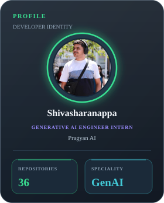
</td>
<td width="52%" valign="top">
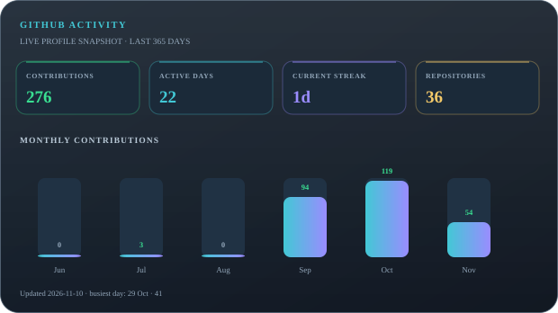
</td>
<td width="25%" valign="top">
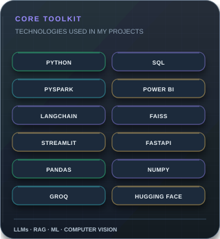
</td>
</tr>
</table>

<table>
<tr>
<td width="33%" valign="top">
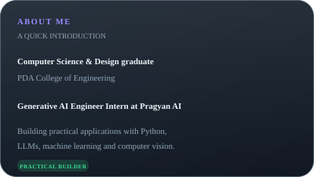
</td>
<td width="34%" valign="top">
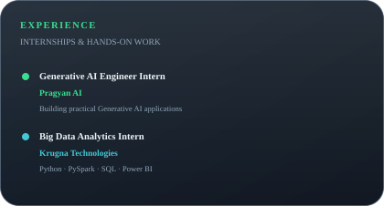
</td>
<td width="33%" valign="top">
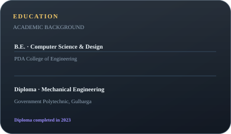
</td>
</tr>
</table>

## SELECTED PROJECTS

<table>
<tr>
<td width="33%">
<a href="https://github.com/Shivasharan53/NammaClean-AI">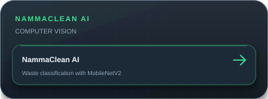</a>
</td>
<td width="33%">
<a href="https://github.com/Shivasharan53/Live-Market-Sales-Analysis">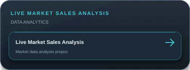</a>
</td>
<td width="33%">
<a href="https://github.com/Shivasharan53/PragyanAI_python_project_Document-Voice-Studio">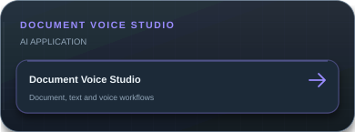</a>
</td>
</tr>
<tr>
<td width="33%">
<a href="https://github.com/Shivasharan53/PragyanAI_python_project_SmartLoan-India">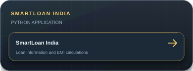</a>
</td>
<td width="33%">
<a href="https://github.com/Shivasharan53/PragyanAI_python_project_CampusScope">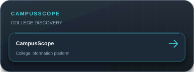</a>
</td>
<td width="33%">
<a href="https://github.com/Shivasharan53/PragyanAI_Image-Studio-project">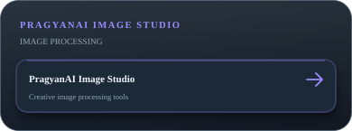</a>
</td>
</tr>
</table>

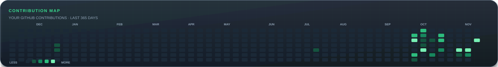

[GitHub](https://github.com/Shivasharan53) · [LinkedIn](https://www.linkedin.com/in/shivasharanappa-genai/) · [Email](mailto:shivasharanappapatil42@gmail.com) · [Portfolio](https://shiva-portfolio.app.orvisai.com)

INNOVATE · BUILD · INSPIRE

