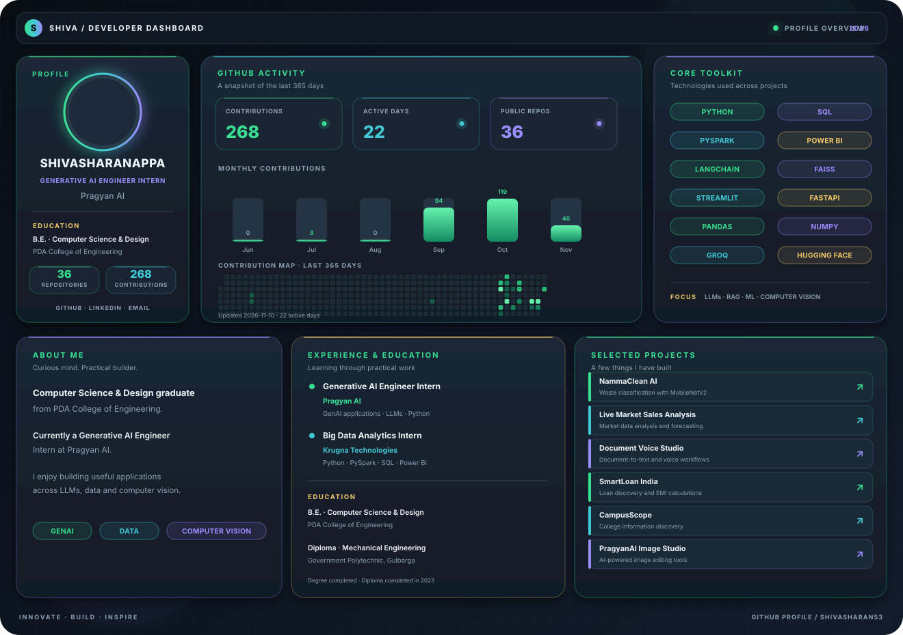

  <a href="https://github.com/Shivasharan53/NammaClean-AI">NammaClean AI</a> ·
  <a href="https://github.com/Shivasharan53/Live-Market-Sales-Analysis">Live Market Analysis</a> ·
  <a href="https://github.com/Shivasharan53/PragyanAI_python_project_Document-Voice-Studio">Document Voice Studio</a> ·
  <a href="https://github.com/Shivasharan53/PragyanAI_python_project_SmartLoan-India">SmartLoan India</a> ·
  <a href="https://github.com/Shivasharan53/PragyanAI_python_project_CampusScope">CampusScope</a> ·
  <a href="https://github.com/Shivasharan53/PragyanAI_Image-Studio-project">PragyanAI Image Studio</a>

  <a href="https://github.com/Shivasharan53">GitHub</a> ·
  <a href="https://www.linkedin.com/in/shivasharanappa-genai/">LinkedIn</a> ·
  <a href="mailto:shivasharanappapatil42@gmail.com">Email</a> ·
  <a href="https://shiva-portfolio.app.orvisai.com">Portfolio</a>

INNOVATE · BUILD · INSPIRE

